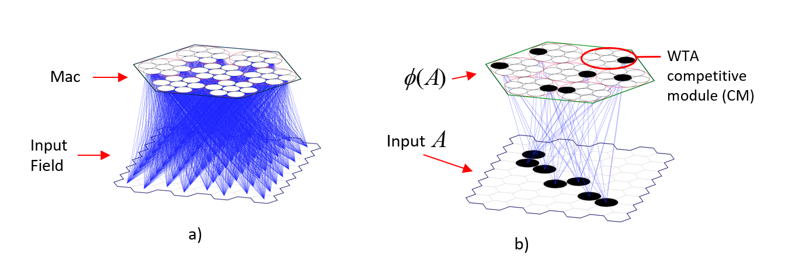

# Active Codes Represent Multiple Hypotheses

In Sparsey, the **mac** is the core processing module. It consists of $Q$ winner-take-all (WTA) **competitive modules** (CMs), each consisting of $K$ binary units ("cells").  Fig. 1a shows a mac with $Q=7$ CMs, each with $K=7$ cells. This architecture **structurally** [i.e., with **zero computational work (thus zero energy expenditure)**] enforces that during both: a) **learning**, i.e., storage of a memory (trace) of an input; and b) **inference**, i.e., retrieval (reactivation) of a previously stored memory trace, exactly $Q$ units will be activated, one per CM.  We call that **set** of $Q$ units a **code** and denote it with Greek letter, $&phi;$.  During a learning event, such as depicted in Fig. 1b, we say that the code is being stored. Fig. 1a,b shows an input level, in this case, an an 8x8 grid of binary input cells that is completely connected to the mac via a bottom-up ("U") matrix of synapses (weights) (blue lines). All weights initially have weight zero (i.e., are "naive"). 

During learning, when an input, e.g., A, presents (i.e., activates in the input level), its active units, here the set of $S=7$ active (black) input units ("pixels") forming a visual contour, send output signals via the U matrix which simultaneously arrive at all of the mac's units.  Upon arrival of these "U" signals, the mac's learning algorithm runs.  That algorithm is described elsewhere, but its essential action is to choose a **set** of $Q$ winners, one in each of the $Q$ CMs, which again, we call a code, e.g., in Fig. 1b, $&phi;(A)$.  Once the code is activated, the synapses (weights) from all $S$ active input units, which we call **active** weights, to all active code units are increased to the maximum weight, "1".  Thus, in Sparsey, the learning event consists of two steps:

- choosing the set of $Q$ winners that will be the code
- increasing (to the max weight) all active afferent synapses to the code. 

I emphasize that this concept of learning, which is inherently suited to *single-trial learning*, and thus human **episodic memory**, is completely different, in spirit and mechanism, from (in fact, is essentially diametrically opposed to) both the concept of learning underlying mainstream AI and the longstanding core concepts of learning in neuroscience. This vast difference is discussed elsewhere.

This set of cells, $&phi;(A)$, constitutes what Hebb called a **"cell assembly"**.  However, this version of the concept of the cell assembly differs significantly from Hebb's definition and to my knowledge, from every other version, e.g., Buzsaki's. Specifically, note that the act of storing the cell assembly, $&phi;(A)$, requires **no changes** to any connections (synapses) that exist **between** the cells comprising the code.  There are such connections but Fig. 1 does not show them: their functionality will be described shortly.  The $Q$ cells become *bound* together as a cell assembly by virtue of the highly, in fact perfectly, **correlated** *changes that occur to their* **afferent** *synapses*.  The afferent U synapses to each of $&phi;(A)$'s cells, whose weights are increased (blue lines in Fig. 1b), come from exactly the same set of input cells. Hence, the $Q$ cells comprising $&phi;(A)$ will effectively function as an whole in response to future inputs in proportion to how similar such future inputs are to A (i.e., in proportion to how many input features such a future input has in common with A).  That is, the more similar an input, B, is to A, the higher the input summations will be for each of $&phi;(A)$'s cells, and thus, the greater the probability of each of these particular cells winning the WTA competitions in their respective CMs, and thus, the higher the expected intersection of the code that gets activated, $&phi;(B)$, with $&phi;(A)$.  Though we haven't shown or discussed them yet, the cells of the mac also have efferent synaptic matrices to other coding areas as well as back to the input level, whose weights will also be changed during learning trials. Thus, the more similar B is to A, the more similar (highly intersecting) $&phi;(B)$ is to $&phi;(A)$, and the more similar the downstream effect will be.  If B is close enough to A so that $&phi;(B)$ = $&phi;(A)$, the downstream effects of B and A will be identical. But again, in this situation where $&phi;(B)$ = $&phi;(A)$, the effective "atomicity" of the cell assembly, $&phi;(A)$, i.e., the fact that all $Q$ of its cells co-activate as a whole, is purely due to correlated changes to these cells' afferent synaptic matrices, ***not*** to any changes to any *intrinsic* connections between those cells.  In contrast, in all other descriptions of cell assemblies, including Hebb's, the formation of the cell assembly is described as being due to changes (weight increases) to the synapses **between** the cells of the cell assembly itself, with relatively less or no emphasis on the correlated changes to the synapses to the cells of the cell assembly. [This essay](https://medium.com/@rod.rinkus/a-hebbian-cell-assembly-is-formed-at-full-strength-on-a-single-trial-d9def1d2fa89?sharedUserId=rod.rinkus) describes Sparsey's novel definition of a cell assembly in more detail.

The above distinction underscores one of Sparsey's crucial assumptions: all cells of a mac have approximately the same **receptive field (RF)**, i.e., set of afferent cells, also called an "inset".  While the theory requires only approximate similarity, the mac's properties, e.g., storage capacity, are maximized and the mathematical analyses of such are cleanest, in the limit where all of a mac's cells have exactly the same RF.  All descriptions, examples, and analyses in these pages and in almost all model instances created/tested thus far make that assumption. Furthermore, in Sparsey, all cells of a mac also have exactly the same **projective field (PF)**, i.e., set of efferent cells, also called an "outset".

Before describing inference (retrieval), we make the following observation.  In our current example, if A is the first input presented to the mac, then after that **single** presentation, all $Q$ cells comprising $&phi;(A)$ will be 100% correlated, i.e., their **tuning functions** (TFs), i.e., sets of increased afferent synapses, will be 100% correlated. In particular, this means that these $Q$ cells will be completely *redundant* in their functionality.  This may seem wasteful at first glance, but it is not.  Over time, each of these $Q$ cells will be chosen *independently* to participate (be included) in the codes of other inputs. Thus, over time, their TFs will, in general, gradually diverge (differentiate), i.e., they will become less redundant in their functionalities.  This point also underscores the radical, again, almost diametrically opposed, difference in the nature of learning in Sparsey vs. that in both mainstream AI and canonical neuroscience.  In Sparsey, learning is abrupt and all-or-none: a code, of maximal synaptic strength, is assigned (stored) in a single *atomic* event, as described above.  This is consistent with the hard reality that an animal operating in the natural world, in principle, cannot know beforehand whether any particular input will be important/crucial (or more generally, contain some useful information) or not.  That is, an animal cannot know, at the time of occurrence of any input whether it should create a strong memory trace of that input.  The importances of any and all inputs can generally only become known over time.  

Nature thus had two possibilities for how animal's brains should function, viz. memory.  On the one hand, the mechanism of biological memory could have developed so that it:
- creates an initially strong (even maximally strong) memory trace of each input that occurs (i.e., in a real-time on-line fashion), and
- allows the strength of a memory trace of a less important input to fade away (or be overwritten) as time passes while allowing the strength of a more important input to remain high and become more permanent (i.e., resistant to decay) as time passes.

On the other hand, biological memory could have developed so that it:
- creates an initially weak memory trace of each input, and
- gradually increases its strengths with each subsequent occurrence of the input.
  
I note that 

Now let's consider inference (retrieval) which includes the several more specific terms, recall, recognition, and prediction.  Sparsey's retrieval algorithm is described elsewhere, but as for learning, its essential action is, given the current inputs to the mac, choose the **set** of $Q$ winners, one per CM, i.e., the code (or, cell assembly), to activate.  The algorithm has two variants, a probabilistic variant, which is in fact identical to the learning algorithm (modulo parameter settings), and a simpler, deterministic variant, in which we simply choose, in each of the $Q$ CMs, the cell with the max input.

If weights never decrease and if the total number of codes stored in the mac remains low enough that interference ("crosstalk") between codes remains below a threshold, then $&phi;(A)$ will be reliably elicited (activated) whenever A is presented again as input to the mac.  And this will be true for all of the codes stored in the mac. Moreover, depending on how many codes have been stored and the structure of the intersections over that set of codes, $&phi;(X)$ can be reliably activated for inputs falling in a range (or space) of similarity to X, and again, similarly for all of the codes stored in the mac.  

Now we will consider an example in which two 2-item sequences have been learned (stored). To do this, we assume that the mac has a complete recurrent matrix of weights. Let the mac consist of $Q$ CMs each having $K$ cells.  Thus, the recurrent matrix consists of $Q^2K^2$ synapses.  As described above, when an item, e.g., X, is presented, e.g., of frame $t$ of the sequence, it gives rise to a code, $&phi;(X)$, in the mac. When the next item, e.g., Y, presents at $t$+1, it gives rise to another code, $&phi;(Y)$ and the $Q^2$ weights from $&phi;(X)$ to $&phi;(Y)$ are set to the max value, again "1" (127).  This can be described as a *temporal Hebbian learning* rule.  Thus, the temporal association from X to Y is stored as this set of weight increases.  This is in addition to the weight increases that occur from the input field to the mac for each of the two items.

So let this sequence, [XY], have been presented (and stored) during learning.  And let a second sequence, [PQ], also have been presented and learned. Suppose the learning (training) period is over and the model is now running in recognition mode. Suppose a novel code (i.e., one that did not occur during learning), $&phi;(a)$, becomes active.  We're using "a" just to label the code: we're not saying that an input "a" has been presented: $&phi;(a)$ is just a novel set of $Q$ cells that has become active in the mac.  Suppose that $&phi;(a)$ has half its $Q$ cells in common with $&phi;(X)$ and the other half in common with the code, $&phi;(P)$.  We can then say that both learned inputs, X and P, are active *at half strength* in the mac.  We can use the terminology that both the hypothesis that input X has been presented as input, or that the state of the input space (world) that generates the input (perception) X exists and the hypothesis that P exists have 50% probability, or that they both are 50% likely.  

Now consider the state of the model after $&phi;(a)$ has activated and it has sent out signals via the recurrent matrix, which will arrive back at the cells of the mac on the next discrete time step. Since $&phi;(a)$ has $Q/2$ in common with $&phi;(X)$, each of the cells comprising $&phi;(Y)$, will have input summations that are only half as large as if $&phi;(X)$ was fully active (i.e., all $Q$ of its cells were active). And since $&phi;(a)$ also has $Q/2$ in common with $&phi;(P)$, each of the cells comprising $&phi;(Q)$, will have input summations that are only half as large as if $&phi;(P)$ was fully active.  And for simplicity, let's assume that all four codes, $&phi;(X)$, $&phi;(Y)$, $&phi;(P)$, and $&phi;(Q)$ are disjoint.  Thus, the situation is that within each of the mac's $Q$ CMs, two cells, the one that is part of $&phi;(X)$ and the one that is part of $&phi;(P)$, are equally implicated by the recurrent signals. Their strengths of implication are only half as strong as the max possible strength.  Now suppose that on the second frame, the input is Y.  Thus, the synaptic signals coming from the input field will deliver maximal summations to each of the $Q$ cells in $&phi;(Y)$ and zero summations to each of the $Q$ cells in $&phi;(Q)$ (because of the disjointness assumption). Thus, if we combine the implications delivered via the recurrent matrix with the implications delivered from the input field, we could unambiguously determine that $&phi;(Y)$ should activate.

[N.b.: Despite the fact that the example being developed here supposes that only two stored codes, $&phi;(X)$ and $&phi;(Y)$, are (partially) active in the supposed novel code, $&phi;(a)$, the astute reader may see that in general, when any code, $&phi;(a)$ (be it novel or learned), becomes active (in particular, during recognition, ***ALL*** codes stored in the mac during learning will be partially active with strength proportional to their intersections with $&phi;(a)$. That is, the ***entire likelihood distribution***, i.e., the likelihoods of ALL stored inputs, *qua* hypotheses, will be physically active in the mac (*qua* memory). Because each of these likelihoods is ***physically reified*** as a particular set of active cells, of cardinality in [0, $Q$] (with 0 representing zero likelihood and $Q$ representing 100% likelihood), we have a clear physical basis by which each of these hypotheses can influence the next state of the ongoing recognition (inference) process. In particular, in the case where $&phi;(a)$ is exactly equal to one particular learned input, e.g., $&phi;(X)$, i.e., $|&phi;(a) \cap &phi;(X)| = Q$, we can say that $&phi;(a)$ simultaneously represents both: a) the single stored input X with 100% strength; and b) the entire likelihood distribution over ALL stored inputs with strengths proportional to their intersections with $&phi;(a)$. This fact is at the core of Sparsey!  It is why Sparsey is so computationally efficient.  It is the magic of representing items of information (i.e., inputs) as SDCs in physical, and classical, *superposition*.  It is what confers **asymptotically** upon Sparsey its property of *constant*, i.e., "O(1)", time complexity best-match (or "approximate") retrieval.  And it is what also confers **asymptotically** upon Sparsey, O(1) learning (storage).  Sparsey's simultaneous **asymptotic** possession of both O(1) storage and O(1) best-match retrieval is unique and in fact, exceeds the capabilities of quantum computing.  I explain this notion of **asymptotic** time complexity elsewhere.  It means "for all practical problems", or that the properties are retained with sub-linear, and likely logarithmic, scaling.  In other words, to double the amount of information that a Sparsey model can store while still possessing O(1) storage and best-match retrieval, the model size (essentially, the number of parameters, i.e., synaptic weights) only needs to increase logarithmically.]

that code e add the weights from the Q active units comprising the code active in the source mac, resulting in the raw U value, denoted u , from that source mac to that target cell. But we know that the max possible input from that mac to the target cell is Q x 127. Thus, we can always normalize the input from that source mac to that cell by that max possible input, resulting in a normed U value, denoted, U , in [0,1], from that mac to the target cell.

But there is a further nuance to this calculation. Specifically, it is generally possible that the code active in a mac represents more than one hypothesis (i.e., more than one possible input). Let λ denote the number of hypotheses strongly (i.e., at close to full strength) represented by the code active in a mac. For example, suppose the code active in mac, m 1 represents λ = 2 previously learned (stored) inputs, A and B, and let the code of A be φ ( A ) and the code of B be φ ( B ) . Now also suppose that on the previous instance when A occurred, it was part of a sequence and it was followed by an input, C, with code, φ ( C ) . And also suppose that on the previous instance when B occurred, it was part of a sequence and it was followed by an input, D, with code, φ ( D ) . This means that on the prior instance, when the sequence [AC] occurred all of the synapses from the Q active units of φ ( A ) onto the Q active units of φ ( C ) will have been increased to their max value of 127.

However, in the current scenario, i.e., with λ = 2 , only Q / 2 of the cells of φ ( A ) are active. That means that on the next frame, the summations to the cells of φ ( C ) will be only half as large as they were in the original instance (when all Q cells of φ ( A ) were active). But since we know that λ = 2 , we can just multiply the input sum in the afferent bundle from the source mac (where φ ( A ) is active at t ) to any cell in the target mac (where φ ( C ) was active at t +1 in the original instance) by λ = 2 . Then the summations, via the afferent bundle from the source mac, all of cells in that target mac will have the same value as if all Q cells of φ ( A ) were active at t .

presented Mechanistically, this means that the cell that is in the code of one of those two hypotheses is currently active in about half, i.e., Q / 2 of the mac's CMs, and the cell that is in the code of the other of those two hypotheses is currently active in the other half of the mac's CMs. Now,

This means that any cell receiving input from that set of Q cells will have an input that is about half of what it would have been in only one hypothesis was represented by the current code. We have an easy way to determine whether or not multiple hypotheses are being represented by an active code. We compute that number and multiply a synapse's weighted value by it to get the total weighted value for the synapse.
