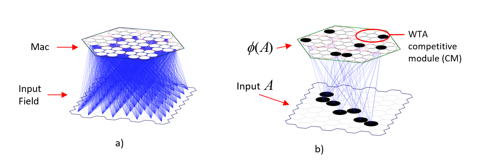

# Architecture and Dynamics of Sparsey's Canonical Computational Module, the "Mac"

In Sparsey, the **mac** is the core processing module. It consists of $Q$ winner-take-all (WTA) **competitive modules** (CMs), each consisting of $K$ binary units ("cells").  Fig. 1a shows a mac with $Q=7$ CMs, each with $K=7$ cells. This architecture **structurally** [i.e., with **zero computational work (thus zero energy expenditure)**] enforces that during both: a) **learning**, i.e., storage of a memory (trace) of an input; and b) **inference**, i.e., retrieval (reactivation) of a previously stored memory trace, exactly $Q$ units will be activated, one per CM.  We call that **set** of $Q$ units a **code** and denote it with Greek letter, $&phi;$.  During a learning event, such as depicted in Fig. 1b, we say that the code is being stored. Fig. 1a,b shows an input level, in this case, an an 8x8 grid of binary input cells that is completely connected to the mac via a bottom-up ("U") matrix of synapses (weights) (blue lines). All weights initially have weight zero (i.e., are "naive"). 

Fig. 2 shows that, in general, an overall Sparsey model instance is hierarchical graph where the graph nodes, call *regions", are 2D arrays of macs. In general, any given mac will receive inputs from: 
a) lower regions in the hierarchy ("U" inputs), which may be input regions (arrays of binary pixels: these input arrays can be of arbitrary dimension, though in these figures, they are all 2D because they represent visual inputs) or 2D arrays of macs; 
b) regions at the same level (horizontal, or "H, inputs), including from itself; 
c) higher-level regions (top-down, or "D", inputs). 

We refer to the set of cells comprising a mac's input as its **receptive field** (RF), which can be partitioned into its U, H, and D, components, referred to as **U-RF**, **H-RF**, and **D-RF**. The connectivity rule is that all cells of a mac have exactly the same RF, thus exactly the same U-RF, H-RF, and D-RF. In general, the RFs of neighboring macs in a region will have overlapping (intersecting) RFs, as shown in Fig. 2.  We present Fig. 2 here only to provide the reader a glimpse of Sparsey's larger-scale operational context, whose policies / dynamics (rules) are described elsewhere.  The goal of this page is to describe the dynamics that occur within, i.e., at the scale of, a single mac.
