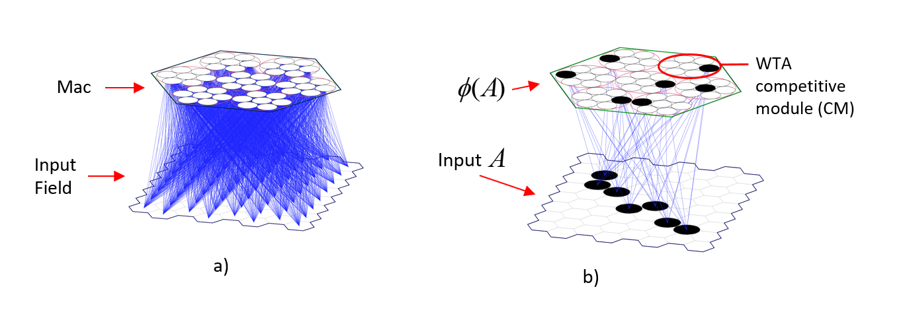
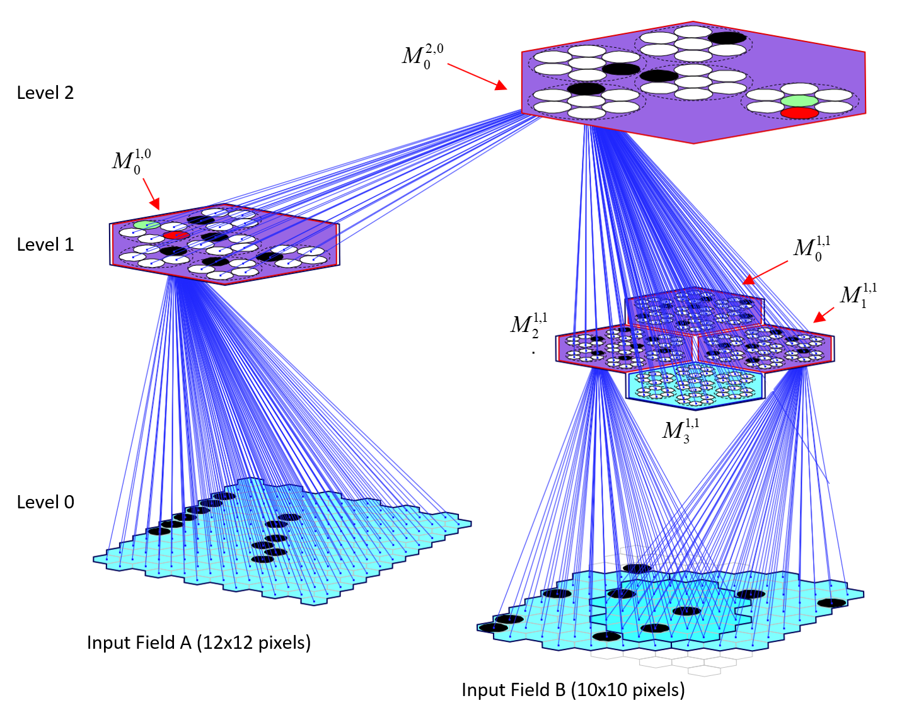
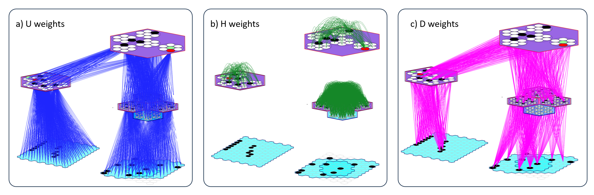

# Architecture and Dynamics of Sparsey's Canonical Computational Module, the "Mac"

In Sparsey, the **mac** is the core processing module. It consists of $Q$ winner-take-all (WTA) **competitive modules** (CMs), each consisting of $K$ binary units ("cells").  Fig. 1a shows a mac with $Q=7$ CMs, each with $K=7$ cells. This architecture **structurally** [i.e., with **zero computational work (thus zero energy expenditure)**] enforces that during both: a) **learning**, i.e., storage of a memory (trace) of an input; and b) **inference**, i.e., retrieval (reactivation) of a previously stored memory trace, exactly $Q$ units will be activated, one per CM.  We call that **set** of $Q$ units a **code** and denote it with Greek letter, $&phi;$.  During a learning event, such as depicted in Fig. 1b, we say that the code is being stored. Fig. 1a,b shows an input level, in this case, an an 8x8 grid of binary input cells that is completely connected to the mac via a bottom-up ("U") matrix of synapses (weights) (blue lines). All weights initially have weight zero (i.e., are "naive"). 

 ### 
 Fig 1. A Small model instance with one mac that receives input from an 8x8 binary pixel input level.

Fig. 2 shows that, in general, an overall Sparsey model instance is hierarchical graph where the graph nodes, call **regions**, are 2D arrays of macs. In general, any given mac will receive inputs (*afferent* synaptic matrices) from: 
1. lower regions in the hierarchy (**"U"** inputs), which may be input regions (arrays of binary features: these input arrays can be of arbitrary dimension, though in these figures, they are all 2D because they represent visual inputs, and so these binary features are also referred to as binary *pixels*) or 2D arrays of macs; 
2. regions at the same level (horizontal, or **"H"**, inputs), including from the mac's own region and including from the mac itself (i.e., a *recurrent* input matrix); 
3. higher-level regions (top-down, or **"D"**, inputs). 

We refer to the set of cells comprising a mac's input as its **receptive field** (**RF**), which can be partitioned into its U, H, and D, components, referred to as **U-RF**, **H-RF**, and **D-RF**.  If the source region of any of a mac's component RFs is an *internal* region, i.e., one composed of macs (as opposed to an input region, which is composed of binary features), then that component RF will be consist of a set of whole macs, i.e., the union of all cells in that set of macs.  The connectivity rule is that all cells of a mac have exactly the same RF, thus exactly the same U-RF, H-RF, and D-RF. In general, the RFs of neighboring macs in a region will have overlapping (intersecting) RFs, as shown in Fig. 2.  We present Fig. 2 here only to provide the reader a glimpse of Sparsey's larger-scale architectural context, whose operational policies / dynamics (rules) are described elsewhere.  The goal of this page is just to describe the dynamics that occur within, i.e., at the scale of, a single mac.

Input region A is 12x12 with visual features present. Input region B is 10x10 and the input is just a random set of 10 active pixels.

### 
 Fig 2. A Small model instance with two input regions, both visual. The blue lines show the U synapses (weights) afferent to one of the active cells in each of the active macs. See text.  

### 
 Fig 3. The same small model instance. Panel a shows all U weights afferent to all active cells in each active mac. Panel b shows the same for the H weights and panel c, for the D weights.

